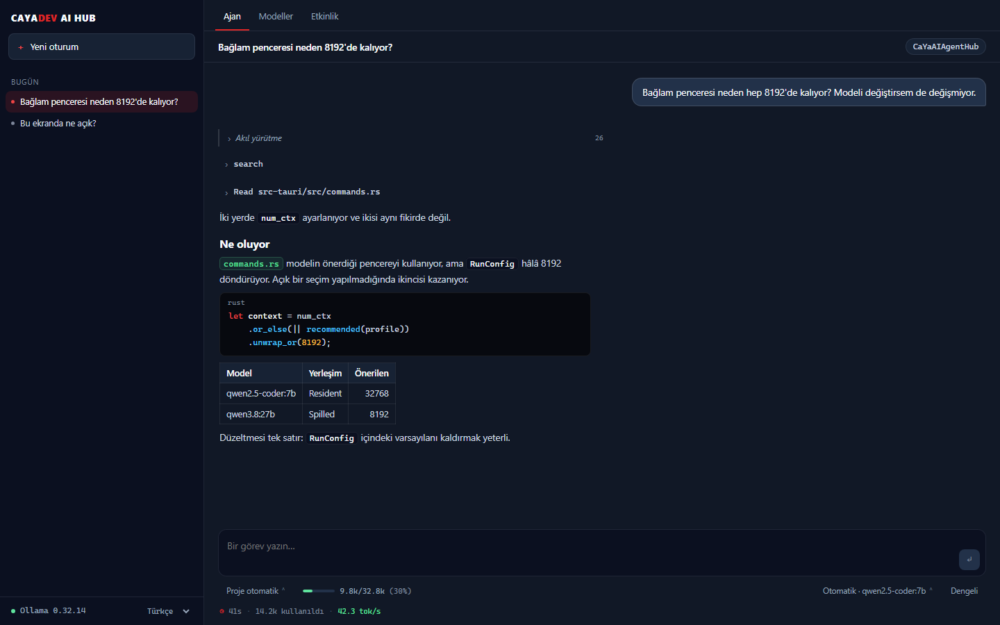
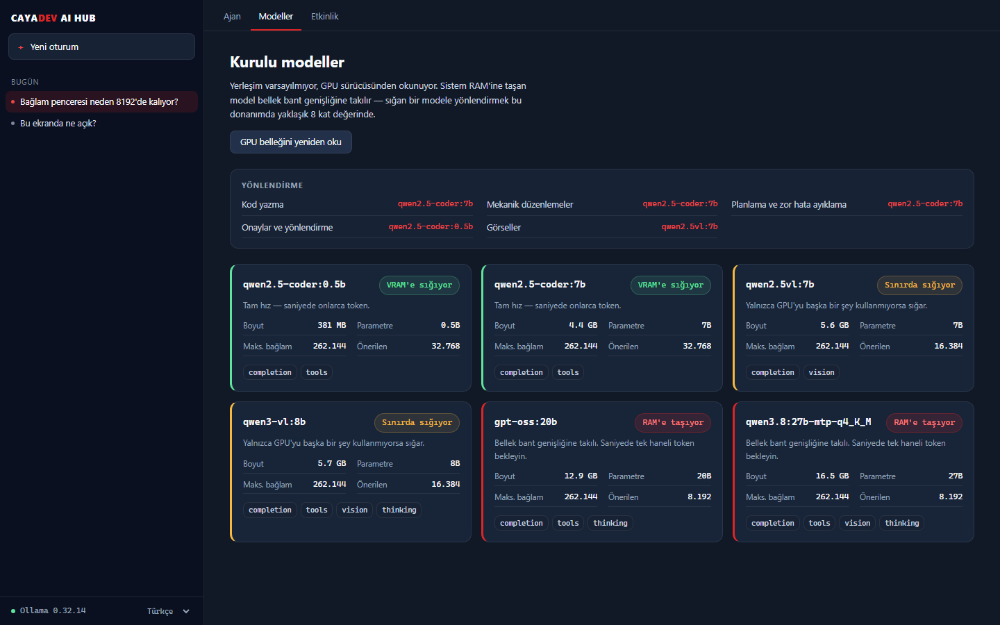
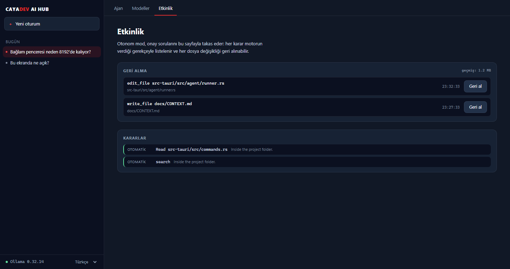
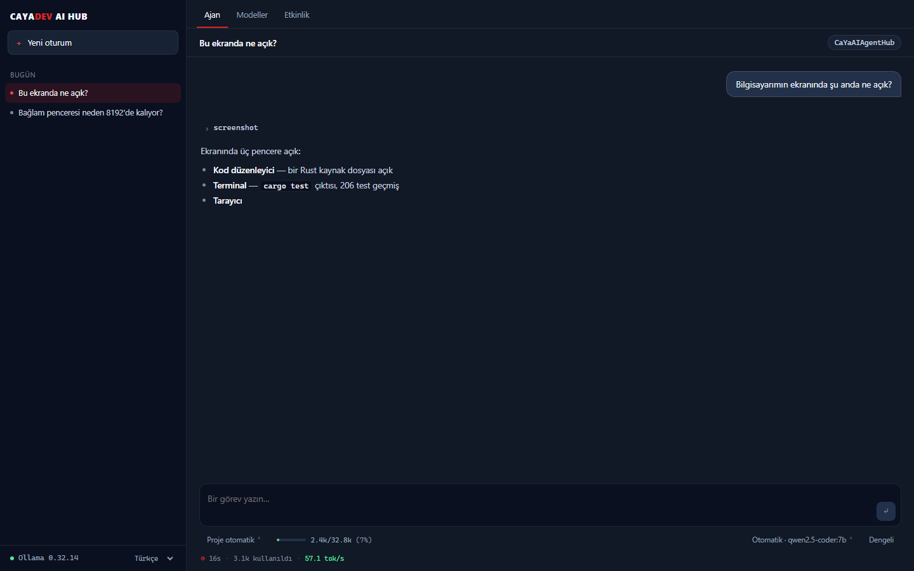

<div align="center">


# CaYaDev AI Hub

**Capable coding agents on local Ollama models — including the small ones.**

[](LICENSE)
[](https://tauri.app)
[](https://ollama.com)



</div>

---

## The problem

Point a general-purpose agent tool at a local model and one of two things
usually happens: the session dies before any work starts, or it crawls. Both
have specific, fixable causes, and neither is really "the model is too small".

| Symptom | Actual cause |
| --- | --- |
| Session ends immediately | The model named a tool that does not exist, and the runner read that as an answer |
| "No tool calls" on a tool-capable model | The model emitted bare JSON in the message body, and a strict parser saw prose |
| Says hello, then takes a screenshot | Twenty tools on offer and nothing telling the model when *not* to use one |
| Hangs, then dies | A *total* request timeout fired during a legitimately slow prefill |
| Painfully slow | A model too large for available VRAM spilled to system RAM |

Every row is measured, and every fix is verified against a real model. See
[`docs/BENCHMARKS.md`](docs/BENCHMARKS.md) and [`docs/SPEED.md`](docs/SPEED.md).

## What makes it fast

Measured on the development machine — an 8 GB laptop GPU:

| Model | Decode | TTFT | Placement |
| --- | ---: | ---: | --- |
| `qwen3.8` 27B Q4_K_M | 5.4 tok/s | 1.5 s | 80% CPU / 20% GPU |
| `qwen2.5-coder:7b` | **42.3 tok/s** | **0.40 s** | 100% GPU |
| `qwen2.5-coder:0.5b` | 316.3 tok/s | 0.19 s | 100% GPU |

A 7B model that fits in VRAM decodes **~8x faster** than a 27B that does not.
No sampling flag closes that gap — context size was measured across a 16x range
on the 27B and every result landed within noise of 5 tok/s.

So the core feature is **task-based routing**: planning goes to the strongest
model that will actually fit, edits go to the fast resident coder, and the
constant yes/no decisions go to a 0.5B that answers in 200 ms.

> **What this does not do:** make a 27B model on an 8 GB card fast. Nothing can —
> that is a memory-bandwidth limit, not a software one.

## Features

**Reliability**
- Tolerant tool-call parsing — recovers calls from `<tool_call>` tags, fenced
  blocks, `<function=name>` tags, bare JSON, and Python-style syntax, with
  repair for single quotes, unquoted keys, trailing commas, and truncated output
- Invented tool names are corrected rather than treated as an answer
- Loop detection that forgets what it saw whenever the run changes something,
  so re-running a failing command after an edit is repair rather than a loop
- Schema validation, and a step ceiling sized to bound an unattended run
  rather than to guess how much work the task needs
- Idle-based timeouts, so a slow prefill is never mistaken for a hang
- Stop actually stops: the flag is polled before every chunk, and it also
  reaches a run parked on an approval or a question
- The conversation is trimmed before it is sent, from the middle, keeping the
  system prompt, the current instruction and the recent steps — Ollama truncates
  from the front, which is where the task lives
- Earlier turns are replayed, with each tool call folded to one summary line, so
  a follow-up knows both what was said and what was already done
- The agent asks rather than guessing: `ask_user` offers choices or a written
  answer, and Skip is reported as a skip

**Speed**
- Task-based routing across reasoning / coding / edit / classify / vision
- GPU memory read from the driver, not assumed
- Byte-stable prompt prefixes — a reused prefix prefills **14.8x** faster
- The tool list is trimmed to what the running model can choose between
- Live tok/s and context occupancy, measured from the first token rather than
  reported after the step

**Safety**
- Five permission modes, from read-only to unrestricted
- Component-wise workspace containment, not fooled by `..` or shared prefixes
- Shell payload inspection: `bash -c "git status && rm -rf /"` is classified by
  its worst segment
- Credentials and catastrophic commands refused in *every* mode
- Publishing to GitHub is confirmed even in unrestricted mode
- Optional model-assisted approval that can only turn "ask" into "allow", is
  never shown a destructive call, and receives computed facts rather than any
  attacker-controllable text
- Every agent edit is checkpointed and revertible from the Activity page —
  stored outside the project, so the agent never finds the app's own journal
- Attachments are copied before the agent sees them, so it can ruin one without
  touching the user's file

**Reach**
- Files: read, write, edit, list, search
- Commands, with output streamed while they run
- GitHub: issues, pull requests, releases, Actions, checks, diffs — with
  multi-command flows collapsed into single calls so small models finish them
- Web search and page reading, no API key
- Documents: PDF, Word, Excel, PowerPoint, CSV
- Attached images go straight into the message, on a model that can see them —
  no second hop through a tool call
- Screenshots of this machine, and Android devices over ADB
- Audio transcription, and video by frame extraction
- Replies rendered as markdown, with syntax colouring and links that open —
  a web link in the browser, a file path in its application
- Turkish and English interface, Turkish by default

**MCP**
- Connect Model Context Protocol servers from the MCP page and choose, per
  server and per tool, what the agent may use
- Two transports: local processes over **stdio** (`npx`, `uvx`, any command,
  with arguments, environment and working directory) and remote servers over
  **Streamable HTTP** (URL, headers, bearer token). The older HTTP+SSE
  transport is not supported
- Test connection lists a server's tools before you save it
- Arguments are checked against each tool's schema; harmless slips are
  repaired and anything else goes back to the model as an error it can fix
- Read-only tools run without asking in Project auto and Balanced; others ask
  unless the server is set to auto-approve
- Models without native tool calling get every tool through a strict JSON
  format in the prompt instead of no tools at all

## Screens

| | |
| --- | --- |
|  |  |
| **Models** — what each one is, where it will actually run, and which task it is routed to. Placement is read from the GPU driver, not assumed. | **Activity** — every file change with a revert button, every decision with the reason the engine gave for it. |
|  | |
| **Seeing the screen** — "what is open on my computer?" goes to a model that can look, not to a shell command. | |

Screenshots are the app itself, rendered over an example transcript by
`scripts/demo/`. The model names and sizes are what the daemon reports on the
development machine and the throughput figures are the measured ones from
[`BENCHMARKS.md`](docs/BENCHMARKS.md); the conversation is written for the
picture.

## Requirements

- [Ollama](https://ollama.com) 0.32+ with at least one model pulled
- Node.js 20+ and Rust 1.80+ to build from source

Optional, each hiding its own tools when absent rather than failing mid-task:

| For | Install |
| --- | --- |
| GitHub tools | [`gh`](https://cli.github.com) |
| PDF / Word / Excel | `pip install pymupdf python-docx openpyxl python-pptx` |
| Transcription | `pip install faster-whisper` |
| Video | `ffmpeg` and `ffprobe` on PATH |
| Android | `adb` on PATH |

## Build

```bash
npm install
npm run tauri dev
```

The tests worth reading are the permission and parser ones:

```bash
cd src-tauri && cargo test
```

Live tests drive real models against a scratch directory:

```bash
cd src-tauri && cargo test --test live_agent -- --ignored --nocapture --test-threads=1
```

Reproduce the measurements on your own hardware:

```bash
npm run bench
```

## Documentation

- [`docs/BENCHMARKS.md`](docs/BENCHMARKS.md) — throughput, and why context size did nothing
- [`docs/SPEED.md`](docs/SPEED.md) — what makes local models faster, and what does not
- [`docs/ROADMAP.md`](docs/ROADMAP.md) — what is built and what is not

## Design

The interface follows the [cayadev.com](https://cayadev.com) palette; tokens are
lifted verbatim from the site's stylesheets into
[`src/styles/tokens.css`](src/styles/tokens.css) rather than re-picked by eye.

## License

MIT — see [LICENSE](LICENSE).
